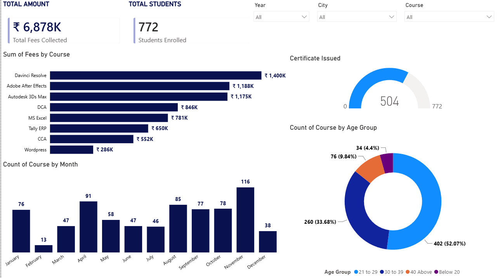

# ABC Institute: Student Enrollment & Fees Dashboard

An interactive Power BI dashboard analysing enrollment, fee collection and certification for a computer training institute.

## Dataset
Public dataset downloaded from Kaggle (original link not recorded). Email and phone columns were removed before uploading. This is a practice project built on public data, not work for a real client.

## Tools
Power BI (data modelling, DAX measures, visuals), Excel (source data)

## Dashboard

**Features:** KPI cards (total fees, students enrolled), fees by course, enrollments by month, age-group split, certificate status, and slicers for Year, City and Course.

## Key Findings
1. **Revenue is concentrated in 3 courses.** DaVinci Resolve, Adobe After Effects and Autodesk 3ds Max bring in about 55% of the ₹6.88M total fees.
2. **The core audience is 21-39.** About 86% of students are in this range, so marketing should target it.
3. **Certificate backlog.** Only 504 of 772 students (65%) have received certificates, leaving 268 pending. This is worth investigating.
4. **Enrollment peaks in November (116) and dips in February (13).** This should be checked against multiple years before calling it seasonality.

## Recommendations
- Expand batches and marketing for the top 3 courses.
- Review why certificates are delayed.
- Run promotions in low months such as February and December.

## Files
- `ABC_institute_dashboard.pbix`: Power BI report
- `screenshots/`: dashboard image
- `data/`: source dataset
